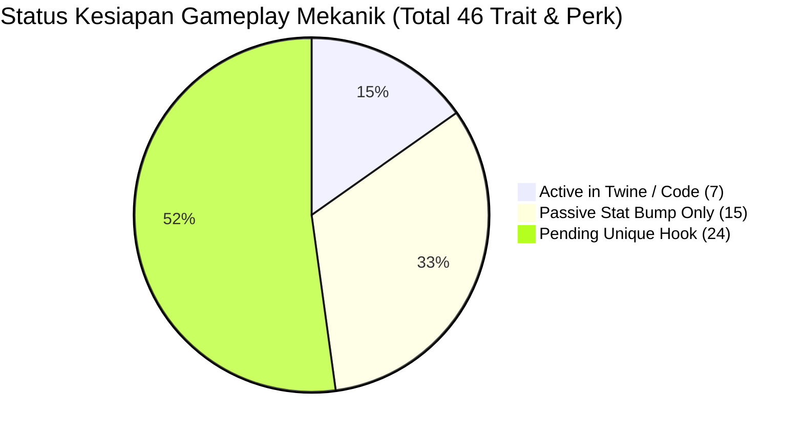
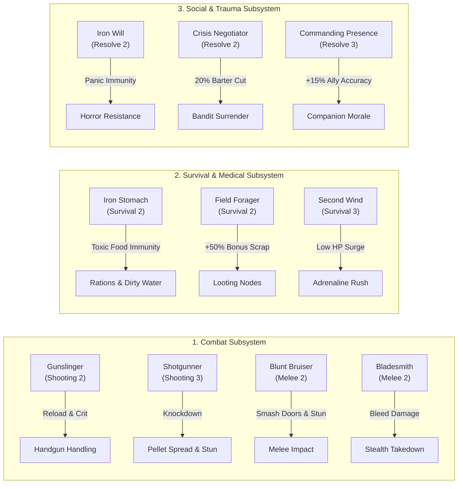

# 06. Gameplay Mechanics: Hobbies, Perks & Status Roadmap
**Sunday: Last Breath // Character Progression & Mechanical Hook Architecture**

---

## 🎯 Executive Overview & Implementation Status Dashboard

Dokumen ini adalah panduan referensi master bagi tim pengembang untuk melacak status implementasi setiap **Hobby (16)**, **Destructive Weakness (20)**, dan **Character Perk (10)**.

Di versi original Twine, sebagian besar trait hanya berupa *flavor text* atau penambahan stat angka dasar. Di Unity, tujuan kita adalah memberikan **gameplay hook unik dan interaktif** bagi setiap pilihan agar terasa berdampak nyata saat dimainkan.

### Status Badge Legend:
* 🟢 **`[ACTIVE]`** — Sudah memiliki percabangan cerita atau kalkulasi di game.
* 🟡 **`[PASSIVE STAT ONLY]`** — Sudah mengubah angka stat awal (HP, Stamina, M.O.R.T.A.L.), tetapi belum memiliki loop mekanik unik di lapangan.
* 🔴 **`[PENDING / BELUM BERGUNA]`** — Deskripsi menjanjikan efek gameplay khusus, namun sistem permainannya **belum dibuat/dihubungkan** di kode game.

---

## 🧩 Bagian 1: Positive Hobbies (16 Total)

### Tab 1: Action & Field (8 Hobbies — Grid $4 \times 2$)

| ID | Title & Icon | Status Saat Ini | Apa yang Dilakukan Sekarang? | Apa yang Masih Kurang? | Kapan & Bagaimana Membuatnya Berguna di Unity? |
| :--- | :--- | :---: | :--- | :--- | :--- |
| **`runner`** | **RUNNER** `trait_runner.png` | 🟡 `PASSIVE STAT` | Menambah Stamina Max (+20/+10) dan +1 AGI (Reflex). | Efek "Can Flee twice" tidak pernah dihitung di kode combat. | **Saat Membangun Combat System:** Tambahkan properti `freeEscapeCharges = 1` per hari. Player bisa kabur dari pertarungan tanpa terkena serangan kesempatan (*Attack of Opportunity*). |
| **`hunter`** | **HUNTER** `trait_hunter.png` | 🟢 `ACTIVE (1 File)` | +1 Shooting, +1 PER (Observation). Membuka 1 cek melacak jejak di Pom Bensin Act 2. | Belum ada mekanik pelacakan di eksplorasi bebas atau bonus perburuan makanan. | **Saat Membangun Scavenging/Overworld System:** Aktifkan visual *Animal Tracks / Infected Trails* di minimap. Memberikan +25% Critical Chance saat menyerang dari semak/stealth. |
| **`boxer`** | **BOXER** `trait_boxer.png` | 🟡 `PASSIVE STAT` | Menambah HP Max (+25/+15) dan +1 STR (Might). Memberi item Boxing Wraps. | Unarmed combat belum memiliki animasi atau mekanik stun unik. | **Saat Membangun Melee Combat System:** Serangan tinju tanpa senjata mengonsumsi 30% stamina lebih hemat dan memiliki peluang 20% memberi efek *Concussion / Stun* selama 1 giliran. |
| **`hiker`** | **HIKER** `trait_hiker.png` | 🟡 `PASSIVE STAT` | +1 Survival, +1 STR (Might). Memberi Trail Mix dan Canteen. | Canteen belum memiliki sistem dehidrasi atau daya tahan air. | **Saat Membangun Survival & Exploration System:** Mengabaikan penalti stamina saat melewati medan berat (reruntuhan beton, lumpur). Air di Canteen bertahan 50% lebih lama sebelum habis. |
| **`archer`** | **ARCHER** `trait_archer.png` | 🔴 `PENDING` | +1 Shooting, +1 AGI (Reflex). Memberi Busur dan Panah. | Deskripsi "Retrieve arrows after kill" belum pernah diprogram. | **Saat Membangun Ranged Combat & Loot System:** Serangan busur memiliki radius suara 0 (senjata sunyi total). Setiap mayat musuh yang dibunuh panah memiliki peluang 60% memunculkan kembali panah untuk diambil. |
| **`baseball`**| **BASEBALL** `trait_baseball.png` | 🟡 `PASSIVE STAT` | +1 Melee, +1 STR (Might). Memberi Baseball Bat dan Bola. | Efek knockback tongkat dan fungsi melempar bola belum aktif. | **Saat Membangun Combat & AI Distraction System:** Ayunan penuh tongkat baseball memukul mundur musuh 2 tile ke belakang. Bola baseball bisa dilempar sebagai umpan suara untuk mengalihkan zombi. |
| **`watchman`**| **WATCHMAN** `trait_watchman.png` | 🟡 `PASSIVE STAT` | +1 PER (Observation), +1 Stealth. Memberi Flashlight dan Kopi. | Belum ada sistem pencahayaan gelap atau debuff kelelahan begadang. | **Saat Membangun Day/Night & Lighting System:** Sinar senter 40% lebih lebar dan baterai senter 50% lebih awet. Mengabaikan penalti akurasi malam hari. |
| **`parkour`** | **PARKOUR** `trait_parkour.png` | 🟡 `PASSIVE STAT` | +1 AGI (Reflex), +1 Stealth. Memberi Sneakers dan Chalk. | Belum ada rute panjat gedung atau bypass rintangan vertikal. | **Saat Membangun Level Design & Traversal System:** Membuka rute panjat tangga darurat (*fire escape*) atau melompati pagar kawat tanpa perlu tali/linggis. Mengurangi damage jatuh 100% dari ketinggian lantai 1. |

---

### Tab 2: Mind & Utility (8 Hobbies — Grid $4 \times 2$)

| ID | Title & Icon | Status Saat Ini | Apa yang Dilakukan Sekarang? | Apa yang Masih Kurang? | Kapan & Bagaimana Membuatnya Berguna di Unity? |
| :--- | :--- | :---: | :--- | :--- | :--- |
| **`mechanic`**| **MECHANIC** `trait_mechanic.png` | 🟢 `ACTIVE (13 Files)` | +1 Tech, +1 INT (Tactics), +1 STR. Hotwire mobil di cerita Twine. | Di Unity belum ada sistem perbaikan generator atau modifikasi senjata. | **Saat Membangun Crafting & Vehicle Repair:** Memperbaiki generator safehouse dan modifikasi senjata membutuhkan 50% lebih sedikit *Scrap Metal*. Mampu menyalakan kendaraan tanpa kunci kontak. |
| **`radio`**   | **RADIO OPERATOR** `trait_radio.png` | 🔴 `PENDING (New)` | +1 INT (Tactics), +1 Tech, +1 Resolve. Memberi Walkie-Talkie & Baterai. | Fitur baru di Unity (Grid balancer). Belum ada sistem radio frekuensi. | **Saat Membangun Radio / World Lore System:** Walkie-talkie menangkap transmisi darurat FEMA/CDC, mengungkap kode pintu bunker rahasia, info cuaca badai asam, dan lokasi airdrop suplai. |
| **`gamer`**   | **GAMER** `trait_gamer.png` | 🔴 `PENDING` | +1 Resolve, +1 INT (Tactics). Memberi Game Console & Energy Drink. | Deskripsi "See % Chance of success" belum terhubung ke UI. | **Saat Membangun HUD Combat & QTE System:** Menampilkan indikator persentase akurasi tembakan dan HP musuh di atas kepala target. Memperlambat kecepatan jarum QTE 15%. |
| **`bookworm`**| **BOOKWORM** `trait_bookworm.png` | 🟡 `PASSIVE STAT` | +1 INT (Tactics), +Humanity (+10/+5). Memberi Kacamata & Buku. | Tidak ada sistem membaca manual atau resep crafting terkunci. | **Saat Membangun Reading & Skill Progression:** Membaca buku manual hanya butuh 1 jam (bukan 4 jam). Membuka resep crafting canggih 1 level lebih cepat dari requirement aslinya. |
| **`volunteer`**| **VOLUNTEER** `trait_volunteer.png` | 🟢 `ACTIVE (4 Files)` | +Humanity (+10/+5), +1 Medicine, +1 Resolve. Diakui Evelyn di Act 3. | Belum ada sistem moral perkemahan atau mood survivor. | **Saat Membangun Camp Morale & Faction System:** Anggota party survivor pulih dari trauma 30% lebih cepat saat istirahat bersama player. Reputasi awal dengan faksi ramah dimulai dari level *Trust*. |
| **`gardener`**| **GARDENER** `trait_gardener.png` | 🟡 `PASSIVE STAT` | +1 Scavenging, +1 PER (Observation). Memberi Salve & Benih. | Belum ada sistem bercocok tanam atau tanaman herbal liar. | **Saat Membangun Base Building & Herbal Medicine:** Memungkinkan bercocok tanam di safehouse untuk suplai makanan berkelanjutan. Menemukan tanaman obat herbal saat looting di taman kota. |
| **`chef`**    | **CHEF** `trait_chef.png` | 🟡 `PASSIVE STAT` | +1 Survival, +Humanity (+10/+5). Memberi Pisau Dapur & Bumbu. | Belum ada sistem memasak makanan mentah/basi. | **Saat Membangun Cooking & Nutrition System:** Makanan yang dimasak oleh Chef menghilangkan risiko keracunan makanan basi dan memberikan buff temporer *Well-Fed* (+15 Max HP) selama 12 jam. |
| **`debater`** | **DEBATER** `trait_debater.png` | 🟡 `PASSIVE STAT` | +1 CHA (Leadership), +1 Resolve. Memberi Voice Recorder. | Belum ada opsi dialog persuasi khusus diplomat. | **Saat Membangun Dialogue & Hostage Encounter:** Membuka opsi dialog khusus bertanda `[PERSUADE]` untuk membujuk bandit bersenjata menurunkan senjata tanpa perlu baku tembak. |

---

## ⚠️ Bagian 2: Destructive Weaknesses (20 Total)

### Tab 1: Physical Flaws (10 Weaknesses — Grid $5 \times 2$)

| ID | Title & Icon | Status Saat Ini | Apa yang Dilakukan Sekarang? | Apa yang Masih Kurang? | Kapan & Bagaimana Membuatnya Berguna di Unity? |
| :--- | :--- | :---: | :--- | :--- | :--- |
| **`smoker`** | **SMOKER** `trait_smoker.png` | 🟡 `PASSIVE ITEM` | -10 Max Stamina. Cek konsumsi rokok pasif di Twine. | Belum ada meteran kecanduan (*Withdrawal Gauge*). | **Saat Membangun Addiction System:** Setiap 4 jam tanpa merokok, player masuk fase *Craving* (-2 PER, -2 AGI, aim sway senjata meningkat 40%). Merokok mengembalikan fokus tetapi menghasilkan asap & suara pemantik. |
| **`alcoholic`**| **ALCOHOLIC** `trait_alcoholic.png` | 🟡 `PASSIVE ITEM` | -10 Max HP. Cek botol whiskey pasif di Twine. | Belum ada efek tangan gemetar (*Tremors*). | **Saat Membangun Addiction System:** Jika tidak minum alkohol selama 12 jam, akurasi menembak turun 35%. Minum alkohol memberikan +2 Might sementara tetapi menurunkan Reflex saat mengemudi. |
| **`asthmatic`**| **ASTHMATIC** `trait_asthmatic.png` | 🟡 `PASSIVE STAT` | -20 Max Stamina. | Belum ada mekanik sesak napas saat lari atau kena asap. | **Saat Membangun Stamina & Hazard System:** Sprinting menghabiskan stamina 50% lebih cepat. Berada di dekat asap/kebakaran memicu batuk keras yang memanggil zombi kecuali segera memakai Inhaler. |
| **`blind`**   | **POOR VISION** `trait_blind.png` | 🟢 `ACTIVE (11 Files)` | -2 PER (Observation). Penalti akurasi di kegelapan di Twine. | Belum ada sistem blur layar atau kacamata pecah. | **Saat Membangun Post-Processing Camera:** Jika kacamata pecah/hilang saat terkena serangan berat, layar diberi efek blur dan jarak pandang mini-map mengecil 50% sampai kacamata diperbaiki. |
| **`badknee`** | **BAD KNEE** `trait_badknee.png` | 🟡 `PASSIVE STAT` | -1 AGI (Reflex). | Belum ada mekanik cedera saat melompat atau beban berat. | **Saat Membangun Inventory Encumbrance:** Membawa beban di atas 70% kapasitas tas menyebabkan player sesekali tersandung. Melompat dari tempat tinggi memicu rasa sakit (-15 Stamina & tidak bisa lari 5 detik). |
| **`glutton`** | **GLUTTON** `trait_glutton.png` | 🟡 `PASSIVE STAT` | Teks konsumsi makanan ganda di Twine. | Belum ada meteran rasa lapar yang aktif. | **Saat Membangun Hunger/Survival Loop:** Meteran rasa lapar berkurang 2x lebih cepat. Saat lapar, Might berkurang -3 dan player secara otomatis memakan ransum di ransel jika moral turun. |
| **`fragile`** | **FRAGILE** `trait_fragile.png` | 🟢 `ACTIVE (2 Files)` | -25 Max HP. Menerima damage ekstra di Twine. | Belum ada mekanik patah tulang atau pendarahan mudah. | **Saat Membangun Trauma & Bleed System:** Serangan tumpul memiliki risiko 40% mematahkan tulang tangan/kaki. Luka terbuka selalu menghasilkan status *Deep Bleeding* yang butuh 2 perban. |
| **`insomniac`**| **INSOMNIAC** `trait_insomniac.png` | 🟡 `PASSIVE STAT` | Pemulihan istirahat dipotong 50%. | Belum ada mekanik kualitas tidur perkemahan. | **Saat Membangun Shelter Rest System:** Tidur di shelter yang dingin atau dekat sarang zombi gagal memulihkan stamina/kelelahan. Butuh *Sleeping Pills* atau tempat tidur mewah untuk tidur nyenyak. |
| **`clumsy`**  | **CLUMSY** `trait_clumsy.png` | 🟡 `PASSIVE STAT` | -2 Stealth. | Belum ada mekanik menjatuhkan barang atau menginjak rintangan berisik. | **Saat Membangun Audio Stealth System:** Berjalan di atas pecahan kaca atau seng mengeluarkan suara 2x lebih nyaring. Peluang 10% senjata terlepas dari tangan saat terkena pukulan telak musuh. |
| **`germophobe`**| **GERMOPHOBE** `trait_germophobe.png` | 🔴 `PENDING` | Teks penalti kebersihan di Twine. | Belum ada mekanik jijik/panik saat menyentuh mayat. | **Saat Membangun Humanity & Infection Loop:** Menjarah mayat zombi atau berjalan di air selokan memicu kehilangan Humanity (-5) dan mual, kecuali player mengenakan masker & sarung tangan bedah. |

---

### Tab 2: Mental & Behavioral Flaws (10 Weaknesses — Grid $5 \times 2$)

| ID | Title & Icon | Status Saat Ini | Apa yang Dilakukan Sekarang? | Apa yang Masih Kurang? | Kapan & Bagaimana Membuatnya Berguna di Unity? |
| :--- | :--- | :---: | :--- | :--- | :--- |
| **`coward`**  | **COWARD** `trait_coward.png` | 🔴 `PENDING` | -2 Resolve. | Belum ada mekanik panik dan kabur otomatis. | **Saat Membangun Morale & Terror System:** Jika dikepung 3+ zombi sekaligus, player menjatuhkan senjata dan dipaksa menyelesaikan QTE mental. Jika gagal, karakter otomatis kabur ke pintu keluar terdekat. |
| **`pyro`**    | **PYROMANIAC** `trait_pyro.png` | 🔴 `PENDING` | Flavor text ketertarikan api di Twine. | Belum ada obsesi menyalakan api. | **Saat Membangun Fire & Thermal Mechanics:** Menolak menjelajahi gedung gelap tanpa membawa obor/flare yang menyala. Membakar zombi menggunakan Molotov memberi buff temporer *Euphoria* (+2 Resolve). |
| **`lonewolf`**| **LONE WOLF** `trait_lonewolf.png` | 🔴 `PENDING` | Flavor text mandiri di Twine. | Belum ada penalti saat party berisi banyak companion. | **Saat Membangun Party Management System:** Moral karakter menurun perlahan jika party memiliki lebih dari 2 companion. Sebaliknya, saat berjalan sendirian, mendapat bonus +15% Scavenging dan +1 Stealth. |
| **`luddite`** | **LUDDITE** `trait_luddite.png` | 🔴 `PENDING` | Skill Tech dikunci ke angka 0 di Twine. | Belum ada larangan interaksi alat elektronik modern. | **Saat Membangun Electronic Puzzles & Terminals:** Karakter tidak bisa mengoperasikan komputer, keypad elektronik, atau GPS tracker. Pintu elektronik hanya bisa dilewati dengan membobol paksa/linggis. |
| **`pacifist`**| **PACIFIST** `trait_pacifist.png` | 🔴 `PENDING` | Flavor text menolak membunuh di Twine. | Belum ada penalti moral saat membunuh manusia. | **Saat Membangun Humanity & Karma System:** Membunuh musuh manusia (bandit/looter) memicu kehilangan Humanity masif (-25) dan status *Guilt* (penalti akurasi tembak). Mendorong taktik non-lethal (taser/asap). |
| **`gambler`** | **GAMBLER** `trait_gambler.png` | 🔴 `PENDING` | Teks "10% Auto-Hit or Auto-Miss" di Twine. | Angka probabilitas 10% belum dihubungkan ke kalkulator dadu tempur. | **Saat Membangun Combat Dice Engine:** Setiap serangan apa pun memiliki peluang 10% selalu Critical Hit (100% tembus armor) atau 10% Senjata Macet (*Weapon Jam*), menciptakan gameplay berisiko tinggi. |
| **`sheltered`**| **SHELTERED** `trait_sheltered.png` | 🟡 `PASSIVE STAT` | -2 Scavenging, +20 Humanity. | Belum ada mekanik mudah tertipu jebakan NPC. | **Saat Membangun NPC Interaction & Traps:** Karakter tidak dapat mendeteksi jebakan kawat ranjau (*tripwires*). Dalam dialog, mudah tertipu oleh sandiwara bandit yang berpura-pura menyerah. |
| **`shopaholic`**| **SHOPAHOLIC** `trait_shopaholic.png` | 🟡 `PASSIVE STAT` | -2 Slot Tas, +1 CHA. | Belum ada larangan membuang barang mewah. | **Saat Membangun Inventory & Barter System:** Menolak membuang perhiasan, jam tangan mewah, atau parfum dari ransel. Barang mewah tersebut dapat dijual ke pedagang kaya dengan harga 200% dari harga normal. |
| **`arrogant`**| **ARROGANT** `trait_arrogant.png` | 🟡 `PASSIVE STAT` | -2 CHA (Leadership), +1 INT. | Belum ada mekanik perselisihan dialog companion. | **Saat Membangun Companion Loyalty System:** Hubungan pertemanan dengan companion meningkat 50% lebih lambat. Opsi dialog sering kali bernada meremehkan, memicu pertengkaran di perkemahan. |
| **`paranoid`**| **PARANOID** `trait_paranoid.png` | 🟢 `ACTIVE (1 File)` | Cek bayangan mencurigakan di Act 3 Twine. | Belum ada larangan tidur dekat companion. | **Saat Membangun Rest & Threat Detection:** Menolak tidur di ruangan yang sama dengan companion lain (-30% kenyamanan tidur). Namun, memiliki radar deteksi instan terhadap musuh yang mengendap-endap. |

---

## 🎖️ Bagian 3: Core Character Perks (10 Total)

Semua perk ini saat ini berstatus **🔴 `[PENDING / BELUM BERGUNA]`** di luar penulisan deskripsi profil karakter. Berikut adalah rencana pengaitannya ke mesin Unity:

| Perk ID | Title & Skill Req | Efek yang Dijanjikan | Kapan & Bagaimana Mengaktifkannya di Kode Unity? |
| :--- | :--- | :--- | :--- |
| **`gunslinger`** | **GUNSLINGER** Shooting 2 | +25% reload speed & +15% critical hit dengan pistol. | **Combat Engine (`WeaponController.cs`):** Jika `character.HasTrait("GUNSLINGER")` dan senjata berjenis Pistol, potong durasi animasi reload sebesar 25% dan tambahkan +15 ke roll crit. |
| **`shotgunner`** | **SHOTGUNNER** Shooting 3 | Knockdown jarak dekat dan sebaran peluru lebih rapat. | **Combat Engine (`WeaponController.cs`):** Tembakan shotgun di jarak $\le 2$ tile memicu trigger animasi roboh (*Knockdown*) pada musuh ukuran manusia dan merapatkan cone tembakan 25%. |
| **`blunt_bruiser`**| **BLUNT BRUISER** Melee 2 | Stun musuh dengan senjata tumpul & hancurkan pintu barikade. | **Interaction System (`DoorInteractable.cs`):** Pintu berbarikade kayu dapat dihancurkan dengan tongkat/palu tanpa linggis. Serangan blunt melee memiliki peluang 35% men-stun musuh. |
| **`bladesmith`** | **BLADESMITH** Melee 2 | Serangan pisau menyebabkan pendarahan & sneak attack kritis. | **Damage Pipeline (`DamageProcessor.cs`):** Menyerang musuh dari belakang dengan pisau memicu takedown senyap instan. Serangan frontal memberikan status *Bleed* (-5 HP per detik selama 6 detik). |
| **`iron_stomach`** | **IRON STOMACH** Survival 2 | Kebal keracunan makanan basi & air keruh. | **Inventory System (`ConsumableItem.cs`):** Cek trait sebelum memicu efek sakit perut/disentri dari item `Stale Ration` atau `Dirty Water`. Jika ada, beri 100% imunitas. |
| **`field_forager`**| **FIELD FORAGER** Survival 2 | Menemukan 50% lebih banyak herba, air bersih & scrap. | **Loot Generator (`LootDropTable.cs`):** Gandakan hasil jarahan tanaman dan komponen scrap sebesar $1.5\times$ saat menjarah node alam liar. |
| **`second_wind`** | **SECOND WIND** Survival 3 | Stamina pulih instan saat HP kritis di bawah 25%. | **Health System (`CharacterHealth.cs`):** Event listener pada perubahan HP. Jika HP jatuh ke $< 25\%$ untuk pertama kalinya dalam pertarungan, pulihkan 50 Stamina dan beri buff lari 8 detik. |
| **`iron_will`** | **IRON WILL** Resolve 2 | Kebal terhadap kepanikan dan mengurangi kehilangan Humanity 40%. | **Sanity System (`HumanityManager.cs`):** Karakter tidak dapat terkena status *Terror / Fleeing*. Setiap event hilangnya Humanity akibat melihat mayat/pembunuhan dikalikan faktor $0.6$. |
| **`crisis_negotiator`**| **CRISIS NEGOTIATOR** Resolve 2 | Mencegah baku tembak dan diskon barter 20%. | **Trade & Dialogue System (`ShopManager.cs`):** Semua harga beli pada pedagang NPC dipotong flat 20%. Membuka opsi menyerah damai saat berpapasan dengan bandit bersenjata. |
| **`commanding_presence`**| **COMMANDING PRESENCE** Resolve 3 | Companion mendapat +15% akurasi dan pantang kabur. | **Party AI Controller (`PartyManager.cs`):** Memberikan aura buff pasif pada semua NPC teman dalam party (+15% akurasi senjata, moral tidak pernah jatuh di bawah ambang batas lari). |

---

## 🗓️ Roadmap Eksekusi: Kapan Membuatnya Berguna?

Agar kamu tidak bingung menentukan prioritas pengerjaan, kelompokkan trait dan perk ke dalam **4 Fase Milestone Pengembangan**:

### 📦 Fase 1: Core Exploration & Inventory Loop (Tugas Selanjutnya)
* **Trait yang Dihubungkan:** `Mechanic`, `Radio Operator`, `Lockpicking`, `Shopaholic`, `Luddite`, `Field Forager`, `Iron Stomach`.
* **Sistem yang Dibuat:** Pintu terkunci, interaksi barang loot, radio darurat, dan konsumsi makanan/air.

### ⚔️ Fase 2: Combat & Action System
* **Trait yang Dihubungkan:** `Runner`, `Hunter`, `Boxer`, `Archer`, `Baseball`, `Gunslinger`, `Shotgunner`, `Blunt Bruiser`, `Bladesmith`, `Second Wind`, `Gambler`.
* **Sistem yang Dibuat:** Kalkulator hit/crit, status stun, sistem kabur (*flee*), dan suara senjata (*stealth vs loud*).

### 🩺 Fase 3: Medical, Trauma & Addiction Loop
* **Trait yang Dihubungkan:** `Smoker`, `Alcoholic`, `Asthmatic`, `Fragile`, `Bad Knee`, `Germophobe`, `Insomniac`.
* **Sistem yang Dibuat:** Durasi efek pendarahan, kebutuhan inhaler, withdrawal rokok/alkohol, dan kualitas tidur di shelter.

### 🤝 Fase 4: Social, Dialogue & Companion Camp
* **Trait yang Dihubungkan:** `Volunteer`, `Debater`, `Coward`, `Lone Wolf`, `Pacifist`, `Sheltered`, `Arrogant`, `Paranoid`, `Iron Will`, `Crisis Negotiator`, `Commanding Presence`.
* **Sistem yang Dibuat:** Pohon dialog persuasif, manajemen moral perkemahan, dan sistem barter pedagang.
